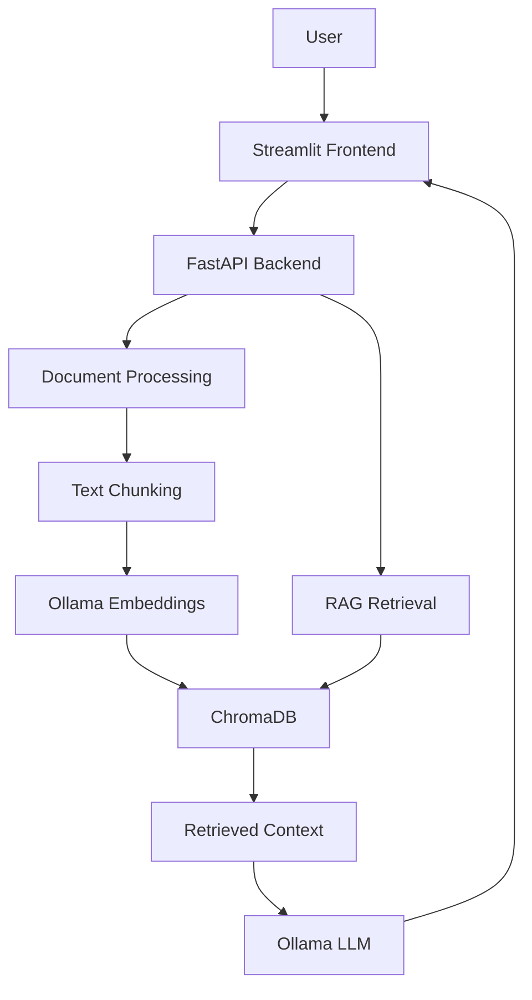

# RAG Portal

A document-based Retrieval-Augmented Generation (RAG) application that allows users to upload PDF and TXT files and ask questions using a locally hosted LLM.

## Technology Stack

- **Backend:** Python, FastAPI
- **Frontend:** Streamlit
- **LLM:** Ollama (Llama 2)
- **Embeddings:** nomic-embed-text
- **Vector Database:** ChromaDB
- **RAG Framework:** LangChain
- **Document Processing:** PyPDF2
- **Deployment:** Docker & Docker Compose

## Features

- Upload and process PDF and TXT documents.
- Extract and split document content into overlapping chunks.
- Generate embeddings and store them in ChromaDB.
- Retrieve relevant document context for user questions.
- Generate context-based answers using a local LLM.
- Display source-document information.
- Run backend, frontend, and Ollama through Docker Compose.

## Architecture



## Project Structure

```text
rag_portal/
├── backend/
│   ├── main.py
│   ├── document_processor.py
│   ├── rag_chain.py
│   ├── requirements.txt
│   └── Dockerfile
├── frontend/
│   ├── app.py
│   ├── requirments.txt
│   └── Dockerfile
├── docker-compose.yml
└── README.md
```

## Run with Docker

Clone the repository:

```bash
git clone https://github.com/Khan-Fazal-sys/rag_portal.git
cd rag_portal
```

Start the services:

```bash
docker compose up --build -d
```

Download the required models:

```bash
docker exec -it ollama ollama pull llama2
docker exec -it ollama ollama pull nomic-embed-text
```

## Application URLs

| Service | URL |
|---|---|
| Streamlit | http://localhost:8501 |
| FastAPI | http://localhost:8000 |
| API Documentation | http://localhost:8000/docs |
| Health Check | http://localhost:8000/health |

## API Endpoints

| Method | Endpoint | Description |
|---|---|---|
| POST | `/upload` | Upload and process a document |
| POST | `/query` | Ask questions about documents |
| GET | `/health` | Check backend health |

## Project Goal

Demonstrate a locally hosted document intelligence system using RAG, vector search, and LLM inference, with a containerized application architecture.

## Author

**Fazal Khan**  
GitHub: [Khan-Fazal-sys](https://github.com/Khan-Fazal-sys)
